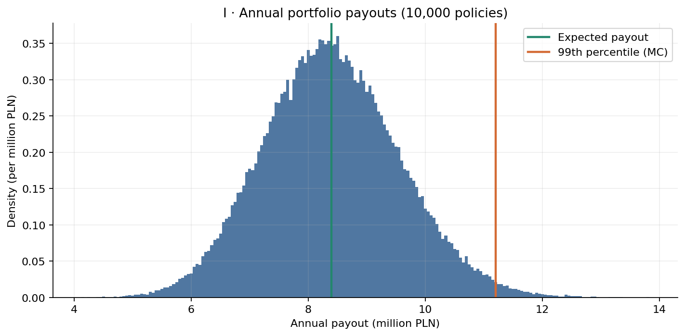
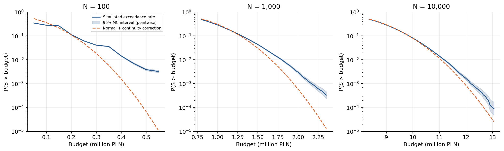

# Monte Carlo Risk Modeling of a Heterogeneous Life Insurance Portfolio

*A one-year payout model using Polish mortality data*

This project models annual death-benefit payouts for 10,000 hypothetical life insurance policies. The portfolio contains six groups with different ages and insured amounts. Death counts are simulated at the group level, and the resulting payouts are used to study the loss distribution, diversification, Monte Carlo convergence and the accuracy of a normal approximation in the upper tail.

The analysis and figures are in [`analysis.ipynb`](analysis.ipynb).

## Data and model

Annual death probabilities come from **Statistics Poland (GUS), *Trwanie życia w 2025 r.*, Table A**, published on 27 July 2026. The project uses the mortality table for men in Poland. The source workbook and the extracted CSV are included in [`data/`](data/); extraction details and source references are documented in [`data/README.md`](data/README.md).

| Age | Annual death probability $q_x$ |
| ---: | ---: |
| 30 | 0.00117 |
| 45 | 0.00346 |
| 60 | 0.01313 |

Policy counts and benefits are hypothetical:

| Age | Policies | Benefit per death (PLN) |
| ---: | ---: | ---: |
| 30 | 1,000 | 50,000 |
| 30 | 2,000 | 100,000 |
| 45 | 1,500 | 100,000 |
| 45 | 1,000 | 200,000 |
| 60 | 2,500 | 50,000 |
| 60 | 2,000 | 200,000 |
| **Total** | **10,000** | |

For each group $g$, $n_g$ is the number of policies, $q_g$ the annual death probability and $K_g$ the benefit. Assuming independent deaths,

```math
D_g\sim\mathrm{Binomial}(n_g,q_g),\qquad S=\sum_g K_gD_g.
```

The analytic mean and variance of the total payout are

```math
\mathbb{E}[S]=\sum_g n_gq_gK_g,\qquad
\mathrm{Var}(S)=\sum_g n_gq_g(1-q_g)K_g^2.
```

Monte Carlo sampling is used to estimate the distribution of $S$ and its upper-tail probabilities.

## Results

### I. Annual payout distribution

From 100,000 simulated portfolio-years:

| Measure | Result |
| :--- | ---: |
| Analytic expected payout | 8,396,750 PLN |
| Simulated mean | 8,398,839 PLN |
| Analytic standard deviation | 1,154,785 PLN |
| Simulated 95th percentile | 10,350,000 PLN |
| Simulated 99th percentile | 11,200,000 PLN |
| $P(S>10{,}750{,}000)$ | 2.436% |

The 95% Wilson interval for the exceedance probability is **2.342%–2.533%**. The budget of 10,750,000 PLN is the analytic mean plus two standard deviations, rounded up to a 50,000 PLN increment.



### II. Diversification and concentration

Scaling all six groups proportionally gives $CV\propto N^{-1/2}$. The fitted slope in the simulation is **−0.5002**. Absolute payout fluctuations increase with portfolio size, while relative fluctuations decrease.

A second portfolio has one tenth as many policies in each group and ten times the benefit per policy. Both portfolios have an expected payout of **8,396,750 PLN**, but the concentrated portfolio has ten times the variance.

| Portfolio | Policies | Analytic variance (PLN²) | Simulated 99th percentile | $P(S>10{,}750{,}000)$ |
| :--- | ---: | ---: | ---: | ---: |
| Baseline | 10,000 | 1,333,529,029,125 | 11,250,000 PLN | 2.293% |
| Concentrated | 1,000 | 13,335,290,291,250 | 18,000,000 PLN | 24.528% |

Experiments I and II use separate random streams.

### III. Monte Carlo convergence

For $M=100$, $1{,}000$, $10{,}000$ and $100{,}000$ simulated years, the mean payout was estimated 30 times using independent random streams. Its theoretical standard error is $\sigma/\sqrt{M}$.

At $M=100{,}000$, the predicted standard error is **3,651.75 PLN** and the observed standard deviation of the 30 estimates is **3,155.13 PLN**. The fitted log-log slope is **−0.5363**, compared with the theoretical value of −0.5.

### IV. Normal approximation in the tail

The simulated distributions for three portfolio sizes are compared with normal distributions using the corresponding analytic means and variances. Exceedance probabilities include a continuity correction for the 50,000 PLN payout grid.

| Policies | Budget (PLN) | Monte Carlo $P(S>B)$ | Normal + correction | MC / normal 99th percentile (PLN) |
| ---: | ---: | ---: | ---: | :--- |
| 100 | 400,000 | 1.449% | 0.157% | 450,000 / 350,000 |
| 1,000 | 1,800,000 | 0.988% | 0.349% | 1,800,000 / 1,700,000 |
| 10,000 | 11,300,000 | 0.790% | 0.561% | 11,200,000 / 11,100,000 |

The normal approximation underestimates upper-tail probabilities in all three cases. The discrepancy decreases as the portfolio grows.



## Run locally

Requires **Python 3.12**, [`uv`](https://docs.astral.sh/uv/) and VS Code with the Python and Jupyter extensions.

```bash
cd life-insurance-monte-carlo
uv sync --locked
code .
```

Open `analysis.ipynb`, select the `.venv/bin/python` kernel and run **Restart & Run All** from the project directory. Mortality data are loaded from the included CSV; the analysis itself needs no internet connection.

The notebook writes five figures, six CSV tables and `summary.json` to [`outputs/`](outputs/). See [`VALIDATION.md`](VALIDATION.md) for reproducibility checks and command-line execution.

## Scope and limitations

The GUS figures describe mortality in the general male population, which may differ from mortality among insured lives. The model assumes independent deaths, fixed one-year death probabilities and specified benefits. It does not account for common mortality shocks, insurance selection, expenses, discounting or reinsurance. The period life table is not a forecast of future mortality for a birth cohort.

## Source and license

Mortality data: [GUS, *Trwanie życia w 2025 r.*, Table A](https://stat.gov.pl/obszary-tematyczne/ludnosc/trwanie-zycia/trwanie-zycia-w-2025-r-%2C2%2C20.html). Acquisition date, extraction and reuse conditions are recorded in [`data/README.md`](data/README.md). Original code and text are published under the [MIT License](LICENSE); the GUS data are subject to their own reuse conditions.
